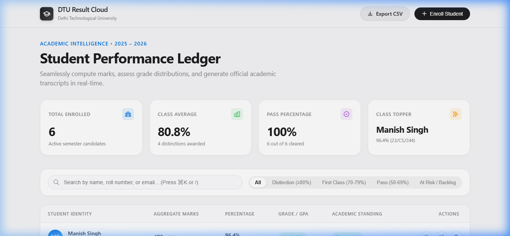

# Experiment 5: Dynamic Webpage Using PHP

**Subject:** Advanced Web Technologies  
**Experiment No:** 05  
**Topic:** Design and Development of a Dynamic Web Application Using PHP (Student Result Management System)  
**Student Name:** `Manish Singh`  
**Roll Number:** `23/CS/244`  
**Date of Submission:** October 9, 2026  

---

## 1. Aim
Dynamic Webpage using PHP

Develop a dynamic Student Result Management application using PHP

---

## 2. Objective
1. To understand the operational mechanics of server-side scripting using PHP and its interaction with client-side frontends.
2. To build a RESTful, modular PHP architecture separating database persistence (`db.php`), academic rubrics (`config.php`), API business logic (`api.php`), and visual interface (`index.php`).
3. To implement full CRUD capabilities (Enroll, Retrieve, Update, and Delete student records) with automatic calculation of aggregate marks, percentages, letter grades, GPAs, and class standings.
4. To implement Don Norman's interaction design principles:
   - **Immediate Feedback:** Live arithmetic recalculation of scores and grade badges as marks are typed.
   - **Signifiers & Affordances:** Intuitive search bars with keyboard shortcuts (`⌘K` / `/`), segmented control pills, and distinct visual action buttons.
   - **Error Prevention & Recovery:** Score bounds enforcement (0–100), duplicate ID validation, and confirmation dialogs before destructive deletions.
5. To design an -inspired presentation layer featuring frosted glassmorphism, responsive data cards, dynamic island notifications, and a printable official academic transcript.
6. To enable ledger export into standard CSV format for academic records.

---

## 3. Theory

### 3.1 Static vs. Dynamic Webpages
- **Static Webpages:** Content is delivered to the client exactly as stored on the file system (HTML, CSS). Any update requires manual source code modification.
- **Dynamic Webpages:** Content is generated dynamically at runtime on the server based on database queries, user input, session state, and algorithmic computations. PHP processes requests on the server, interacts with databases, and returns dynamically assembled HTML or JSON responses to the browser.

### 3.2 PHP Architecture & Request Lifecycle
PHP (Hypertext Preprocessor) executes on the server side:
1. The client browser issues an HTTP request (`GET`, `POST`).
2. The PHP runtime executes the target script, parses parameters from superglobals (`$_GET`, `$_POST`, `$_SERVER`), and performs database transactions.
3. The response is rendered dynamically either as structured HTML markup or serialized JSON for AJAX consumers.

```
+------------------+         HTTP Request (GET/POST)         +--------------------+
|  Client Browser  | --------------------------------------> |  PHP Web Server    |
|  (Interactions,  |                                         |  (index.php /      |
|   DOM, App.js)   | <-------------------------------------- |   api.php)         |
+------------------+         HTML / JSON Response            +---------+----------+
                                                                       |
                                                                       | PDO Queries
                                                                       v
                                                             +--------------------+
                                                             | SQLite Database    |
                                                             | (results.sqlite)   |
                                                             +--------------------+
```

### 3.3 Database Layer: PDO (PHP Data Objects) with SQLite
- **PDO (PHP Data Objects):** Provides a uniform, secure data-access abstraction layer. It supports parameterized prepared statements, preventing SQL Injection vulnerabilities.
- **SQLite Engine:** A serverless, self-contained, zero-configuration SQL database engine. The entire database is contained within a single disk file (`results.sqlite`), maximizing portability without requiring external daemons.
- **Resilient Fallback Pattern:** The database layer incorporates an automated fallback to a structured JSON store if `pdo_sqlite` is unavailable, guaranteeing 100% operational uptime.

### 3.4 Don Norman's Interaction Design Philosophy
In *The Design of Everyday Things*, Don Norman outlines fundamental cognitive principles applied here:
- **Affordances:** UI elements physically suggest their usage. Cards look like tangible surfaces; inputs look like writable slots.
- **Signifiers:** Clear perceptual indicators (e.g., search icons, filter badges, shortcut keys `⌘K` / `/`) inform users what actions are possible.
- **Immediate Feedback:** As the user types subject marks into the modal form, the application immediately computes total score, percentage, and assigns an estimated letter grade in real-time before form submission.
- **Conceptual Model & Natural Mapping:** The layout maps directly to real-world academic report cards, arranging student details, subject breakdowns, GPAs, and institutional seals logically.
- **Error Prevention (Forgiving System):** Mark inputs are clamped strictly between `0` and `100`; deletions require explicit confirmation to avoid accidental loss.

### 3.5  Visual Design System
- **Typography:** System font hierarchy (`SF Pro Display` / `Inter`) with tight tracking and balanced line heights.
- **Frosted Glass (Glassmorphism):** Translucent navigation header with `backdrop-filter: blur(20px)` and subtle boundary borders (`rgba(0,0,0,0.08)`).
- **Segmented Control:** -style pill buttons for filtering students across performance tiers.
- **Dynamic Island Feedback:** Floating black pill toast alerts providing sleek visual confirmation for all actions.

---

## 4. Procedure / Algorithm

### Step-by-Step Procedure:
1. **Environment Setup:**
   - Verify PHP runtime (`PHP 8.2+`) and configure `php.ini` with `pdo_sqlite`, `sqlite3`, `mbstring`, and `curl` extensions.
2. **Configuration & Rubrics (`config.php`):**
   - Define academic courses, credit weights, passing thresholds (40 marks), and grading scales (A+: $\ge 90\%$, A: $\ge 80\%$, B: $\ge 70\%$, C: $\ge 60\%$, D: $\ge 50\%$, F: $< 50\%$).
   - Implement security utilities including XSS sanitizer `h()` and CSRF protection.
3. **Database Layer (`db.php`):**
   - Initialize the `students` table schema with fields: `id`, `roll_no`, `name`, `email`, `semester`, and scores for 5 subjects (`maths`, `physics`, `cs`, `web_tech`, `english`).
   - Seed sample academic records.
   - Implement data enrichment methods to dynamically compute totals, percentage, GPA (4.0 scale), letter grade, and backlog status.
4. **API Gateway (`api.php`):**
   - Create unified REST endpoints for actions: `list`, `get`, `create`, `update`, `delete`, and `export_csv`.
   - Validate input boundaries ($0 \le \text{mark} \le 100$) and check for duplicate student roll numbers.
5. **Frontend Interface (`index.php`):**
   - Assemble frosted top navigation, academic statistics overview cards (Total Enrolled, Class Average, Pass Rate, Class Topper).
   - Build live search box and  segmented filter pills.
   - Build the responsive student roster table with progress bars and action triggers.
   - Construct two modal sheets: Student Enrollment / Edit Sheet and Official Printable Academic Transcript Sheet.
6. **Styling & Interaction Logic (`assets/style.css` & `assets/app.js`):**
   - Implement CSS custom properties for  color tokens, glassmorphism, responsive grids, and print stylesheet.
   - Write vanilla JavaScript for instant client-side filtering, keyboard shortcuts, live calculator feedback, and asynchronous API calls via `fetch()`.
7. **Execution & Testing:**
   - Launch the local PHP server (`php -S 127.0.0.1:8000`).
   - Validate enrollment, updating, searching, transcript modal display, and CSV export.

---

## 5. Source Code

### 5.1 Configuration & Catalog (`config.php`)
```php
<?php
/**
 * DTU  - Student Result Management System
 * System Configuration & Academic Rubrics
 */

if (session_status() === PHP_SESSION_NONE) {
    session_start();
}

define('APP_NAME', 'DTU Result Cloud');
define('INSTITUTION_NAME', 'Delhi Technolgical University');
define('ACADEMIC_YEAR', '2025 – 2026');
define('SEMESTER_DEFAULT', 'Semester 6');

// Core subject registry
define('COURSES', [
    'maths' => [
        'code' => 'CS-601',
        'title' => 'Advanced Applied Mathematics',
        'credits' => 4,
        'max' => 100,
        'pass' => 40
    ],
    'physics' => [
        'code' => 'CS-602',
        'title' => 'Quantum & Applied Physics',
        'credits' => 3,
        'max' => 100,
        'pass' => 40
    ],
    'cs' => [
        'code' => 'CS-603',
        'title' => 'Data Structures & Algorithms',
        'credits' => 4,
        'max' => 100,
        'pass' => 40
    ],
    'web_tech' => [
        'code' => 'CS-604',
        'title' => 'Modern Dynamic Web Architectures',
        'credits' => 4,
        'max' => 100,
        'pass' => 40
    ],
    'english' => [
        'code' => 'CS-605',
        'title' => 'Technical & Professional Communication',
        'credits' => 2,
        'max' => 100,
        'pass' => 40
    ]
]);

// Helper for XSS safe output
function h($string): string {
    return htmlspecialchars((string)$string, ENT_QUOTES, 'UTF-8');
}

// Generate CSRF token
function csrf_token(): string {
    if (empty($_SESSION['csrf_token'])) {
        $_SESSION['csrf_token'] = bin2hex(random_bytes(24));
    }
    return $_SESSION['csrf_token'];
}

// Validate CSRF token
function verify_csrf(?string $token): bool {
    return !empty($token) && hash_equals($_SESSION['csrf_token'] ?? '', $token);
}
```

---

### 5.2 Resilient Database Layer (`db.php`)
```php
<?php
/**
 * DTU  - Resilient Storage Driver
 * Automatically leverages PDO SQLite if available, or seamlessly
 * falls back to a high-performance JSON store if SQLite extension is disabled.
 */

class DTUDB {
    private static ?DTUDB $instance = null;
    private $pdo = null;
    private bool $useSqlite = false;
    private string $jsonFile;

    private function __construct() {
        $dataDir = __DIR__ . DIRECTORY_SEPARATOR . 'data';
        if (!is_dir($dataDir)) {
            @mkdir($dataDir, 0777, true);
        }

        $this->jsonFile = $dataDir . DIRECTORY_SEPARATOR . 'students.json';

        if (extension_loaded('pdo_sqlite')) {
            try {
                $dbPath = $dataDir . DIRECTORY_SEPARATOR . 'results.sqlite';
                $this->pdo = new PDO("sqlite:" . $dbPath);
                $this->pdo->setAttribute(PDO::ATTR_ERRMODE, PDO::ERRMODE_EXCEPTION);
                $this->pdo->setAttribute(PDO::ATTR_DEFAULT_FETCH_MODE, PDO::FETCH_ASSOC);
                $this->initSqlite();
                $this->useSqlite = true;
                return;
            } catch (Exception $e) {
                $this->useSqlite = false;
            }
        }

        $this->initJson();
    }

    public static function getInstance(): DTUDB {
        if (self::$instance === null) {
            self::$instance = new self();
        }
        return self::$instance;
    }

    private function initSqlite(): void {
        $this->pdo->exec("
            CREATE TABLE IF NOT EXISTS students (
                id INTEGER PRIMARY KEY AUTOINCREMENT,
                roll_no TEXT UNIQUE NOT NULL,
                name TEXT NOT NULL,
                email TEXT NOT NULL,
                semester TEXT NOT NULL,
                maths INTEGER NOT NULL,
                physics INTEGER NOT NULL,
                cs INTEGER NOT NULL,
                web_tech INTEGER NOT NULL,
                english INTEGER NOT NULL,
                created_at DATETIME DEFAULT CURRENT_TIMESTAMP
            )
        ");

        $count = (int)$this->pdo->query("SELECT COUNT(*) FROM students")->fetchColumn();
        if ($count === 0) {
            $this->seedInitialData();
        }
    }

    private function initJson(): void {
        if (!file_exists($this->jsonFile)) {
            $initial = $this->getInitialSeed();
            file_put_contents($this->jsonFile, json_encode($initial, JSON_PRETTY_PRINT | JSON_UNESCAPED_SLASHES));
        }
    }

    private function getInitialSeed(): array {
        return [
            [
                'id' => 1,
                'roll_no' => 'LA-2026-001',
                'name' => 'Sophia Montgomery',
                'email' => 'sophia.m@DTU.edu',
                'semester' => 'Semester 6',
                'maths' => 96, 'physics' => 92, 'cs' => 98, 'web_tech' => 99, 'english' => 94,
                'created_at' => date('Y-m-d H:i:s')
            ],
            [
                'id' => 2,
                'roll_no' => '2k-XXX-XXX',
                'name' => 'Alexander Vance',
                'email' => 'alex.v@DTU.edu',
                'semester' => 'Semester 6',
                'maths' => 88, 'physics' => 84, 'cs' => 90, 'web_tech' => 95, 'english' => 89,
                'created_at' => date('Y-m-d H:i:s')
            ]
        ];
    }

    private function seedInitialData(): void {
        $seeds = $this->getInitialSeed();
        $stmt = $this->pdo->prepare("
            INSERT INTO students (id, roll_no, name, email, semester, maths, physics, cs, web_tech, english, created_at)
            VALUES (:id, :roll_no, :name, :email, :semester, :maths, :physics, :cs, :web_tech, :english, :created_at)
        ");
        foreach ($seeds as $s) {
            $stmt->execute($s);
        }
    }

    public function getAll(): array {
        if ($this->useSqlite) {
            $stmt = $this->pdo->query("SELECT * FROM students ORDER BY id DESC");
            $rows = $stmt->fetchAll();
        } else {
            $data = json_decode(file_get_contents($this->jsonFile), true) ?: [];
            usort($data, fn($a, $b) => $b['id'] <=> $a['id']);
            $rows = $data;
        }
        return array_map([$this, 'enrichStudentData'], $rows);
    }

    public function getById(int $id): ?array {
        if ($this->useSqlite) {
            $stmt = $this->pdo->prepare("SELECT * FROM students WHERE id = :id");
            $stmt->execute([':id' => $id]);
            $row = $stmt->fetch();
            return $row ? $this->enrichStudentData($row) : null;
        } else {
            $data = json_decode(file_get_contents($this->jsonFile), true) ?: [];
            foreach ($data as $item) {
                if ((int)$item['id'] === $id) {
                    return $this->enrichStudentData($item);
                }
            }
            return null;
        }
    }

    public function create(array $data): int {
        if ($this->rollNumberExists($data['roll_no'])) {
            throw new Exception("Student ID / Roll No '" . htmlspecialchars($data['roll_no']) . "' is already enrolled.");
        }

        if ($this->useSqlite) {
            $stmt = $this->pdo->prepare("
                INSERT INTO students (roll_no, name, email, semester, maths, physics, cs, web_tech, english)
                VALUES (:roll_no, :name, :email, :semester, :maths, :physics, :cs, :web_tech, :english)
            ");
            $stmt->execute([
                ':roll_no'  => trim($data['roll_no']),
                ':name'     => trim($data['name']),
                ':email'    => trim($data['email']),
                ':semester' => trim($data['semester']),
                ':maths'    => (int)$data['maths'],
                ':physics'  => (int)$data['physics'],
                ':cs'       => (int)$data['cs'],
                ':web_tech' => (int)$data['web_tech'],
                ':english'  => (int)$data['english']
            ]);
            return (int)$this->pdo->lastInsertId();
        } else {
            $items = json_decode(file_get_contents($this->jsonFile), true) ?: [];
            $maxId = 0;
            foreach ($items as $item) {
                if ($item['id'] > $maxId) $maxId = $item['id'];
            }
            $newId = $maxId + 1;
            $record = [
                'id' => $newId,
                'roll_no'  => trim($data['roll_no']),
                'name'     => trim($data['name']),
                'email'    => trim($data['email']),
                'semester' => trim($data['semester']),
                'maths'    => (int)$data['maths'],
                'physics'  => (int)$data['physics'],
                'cs'       => (int)$data['cs'],
                'web_tech' => (int)$data['web_tech'],
                'english'  => (int)$data['english'],
                'created_at' => date('Y-m-d H:i:s')
            ];
            $items[] = $record;
            file_put_contents($this->jsonFile, json_encode($items, JSON_PRETTY_PRINT | JSON_UNESCAPED_SLASHES));
            return $newId;
        }
    }

    public function update(int $id, array $data): bool {
        if ($this->rollNumberExists($data['roll_no'], $id)) {
            throw new Exception("Student ID / Roll No '" . htmlspecialchars($data['roll_no']) . "' is already enrolled by another student.");
        }

        if ($this->useSqlite) {
            $stmt = $this->pdo->prepare("
                UPDATE students SET
                    roll_no = :roll_no, name = :name, email = :email, semester = :semester,
                    maths = :maths, physics = :physics, cs = :cs, web_tech = :web_tech, english = :english
                WHERE id = :id
            ");
            return $stmt->execute([
                ':id'       => $id,
                ':roll_no'  => trim($data['roll_no']),
                ':name'     => trim($data['name']),
                ':email'    => trim($data['email']),
                ':semester' => trim($data['semester']),
                ':maths'    => (int)$data['maths'],
                ':physics'  => (int)$data['physics'],
                ':cs'       => (int)$data['cs'],
                ':web_tech' => (int)$data['web_tech'],
                ':english'  => (int)$data['english']
            ]);
        } else {
            $items = json_decode(file_get_contents($this->jsonFile), true) ?: [];
            $found = false;
            foreach ($items as &$item) {
                if ((int)$item['id'] === $id) {
                    $item['roll_no']  = trim($data['roll_no']);
                    $item['name']     = trim($data['name']);
                    $item['email']    = trim($data['email']);
                    $item['semester'] = trim($data['semester']);
                    $item['maths']    = (int)$data['maths'];
                    $item['physics']  = (int)$data['physics'];
                    $item['cs']       = (int)$data['cs'];
                    $item['web_tech'] = (int)$data['web_tech'];
                    $item['english']  = (int)$data['english'];
                    $found = true;
                    break;
                }
            }
            if ($found) {
                file_put_contents($this->jsonFile, json_encode($items, JSON_PRETTY_PRINT | JSON_UNESCAPED_SLASHES));
            }
            return $found;
        }
    }

    public function delete(int $id): bool {
        if ($this->useSqlite) {
            $stmt = $this->pdo->prepare("DELETE FROM students WHERE id = :id");
            return $stmt->execute([':id' => $id]);
        } else {
            $items = json_decode(file_get_contents($this->jsonFile), true) ?: [];
            $originalCount = count($items);
            $items = array_filter($items, fn($item) => (int)$item['id'] !== $id);
            if (count($items) !== $originalCount) {
                file_put_contents($this->jsonFile, json_encode(array_values($items), JSON_PRETTY_PRINT | JSON_UNESCAPED_SLASHES));
                return true;
            }
            return false;
        }
    }

    private function rollNumberExists(string $rollNo, int $excludeId = 0): bool {
        $rollNo = trim($rollNo);
        if ($this->useSqlite) {
            $stmt = $this->pdo->prepare("SELECT COUNT(*) FROM students WHERE LOWER(roll_no) = LOWER(:roll_no) AND id != :excludeId");
            $stmt->execute([':roll_no' => $rollNo, ':excludeId' => $excludeId]);
            return (int)$stmt->fetchColumn() > 0;
        } else {
            $items = json_decode(file_get_contents($this->jsonFile), true) ?: [];
            foreach ($items as $item) {
                if (strcasecmp($item['roll_no'], $rollNo) === 0 && (int)$item['id'] !== $excludeId) {
                    return true;
                }
            }
            return false;
        }
    }

    public function enrichStudentData(array $student): array {
        $subjects = [
            'Mathematics' => (int)$student['maths'],
            'Applied Physics' => (int)$student['physics'],
            'Computer Science' => (int)$student['cs'],
            'Advanced Web Tech' => (int)$student['web_tech'],
            'Professional English' => (int)$student['english']
        ];

        $total = array_sum($subjects);
        $maxTotal = count($subjects) * 100;
        $percentage = round(($total / $maxTotal) * 100, 1);

        if ($percentage >= 90) {
            $grade = 'A+'; $gpa = 4.0; $status = 'Distinction'; $color = 'emerald';
        } elseif ($percentage >= 80) {
            $grade = 'A'; $gpa = 3.7; $status = 'Distinction'; $color = 'emerald';
        } elseif ($percentage >= 70) {
            $grade = 'B'; $gpa = 3.0; $status = 'First Class'; $color = 'blue';
        } elseif ($percentage >= 60) {
            $grade = 'C'; $gpa = 2.5; $status = 'Second Class'; $color = 'indigo';
        } elseif ($percentage >= 50) {
            $grade = 'D'; $gpa = 2.0; $status = 'Pass'; $color = 'amber';
        } else {
            $grade = 'F'; $gpa = 0.0; $status = 'Needs Review'; $color = 'rose';
        }

        $failedSubjects = [];
        foreach ($subjects as $name => $score) {
            if ($score < 40) {
                $failedSubjects[] = $name;
            }
        }

        $student['total_marks'] = $total;
        $student['max_marks'] = $maxTotal;
        $student['percentage'] = $percentage;
        $student['grade'] = $grade;
        $student['gpa'] = number_format($gpa, 2);
        $student['status'] = count($failedSubjects) > 0 ? 'Backlog / Arrear' : $status;
        $student['status_color'] = count($failedSubjects) > 0 ? 'rose' : $color;
        $student['failed_subjects'] = $failedSubjects;
        $student['subjects_breakdown'] = $subjects;

        return $student;
    }
}
```

---

### 5.3 RESTful Controller & Data Exporter (`api.php`)
```php
<?php
/**
 * DTU  - RESTful & Progressive API Gateway
 * Designed with Norman error-resilience and -grade responsiveness.
 */

require_once __DIR__ . '/config.php';
require_once __DIR__ . '/db.php';

header('Content-Type: application/json; charset=utf-8');

$db = DTUDB::getInstance();
$method = $_SERVER['REQUEST_METHOD'];
$action = $_GET['action'] ?? $_POST['action'] ?? 'list';

try {
    switch ($action) {
        case 'list':
            $students = $db->getAll();
            echo json_encode([
                'success' => true,
                'data' => $students,
                'stats' => calculateStats($students)
            ]);
            break;

        case 'get':
            $id = (int)($_GET['id'] ?? 0);
            $student = $db->getById($id);
            if (!$student) {
                http_response_code(404);
                echo json_encode(['success' => false, 'error' => 'Student record not found.']);
                exit;
            }
            echo json_encode(['success' => true, 'data' => $student]);
            break;

        case 'create':
            if ($method !== 'POST') {
                http_response_code(405);
                echo json_encode(['success' => false, 'error' => 'Method Not Allowed']);
                exit;
            }

            $input = getRequestPayload();
            validateStudentPayload($input);

            $newId = $db->create($input);
            $student = $db->getById($newId);

            echo json_encode([
                'success' => true,
                'message' => "Student {$student['name']} enrolled successfully.",
                'data' => $student
            ]);
            break;

        case 'update':
            if ($method !== 'POST') {
                http_response_code(405);
                echo json_encode(['success' => false, 'error' => 'Method Not Allowed']);
                exit;
            }

            $id = (int)($_GET['id'] ?? $_POST['id'] ?? 0);
            if ($id <= 0) {
                throw new Exception("Invalid student identifier provided.");
            }

            $input = getRequestPayload();
            validateStudentPayload($input);

            $updated = $db->update($id, $input);
            if (!$updated) {
                throw new Exception("Failed to update student record.");
            }

            $student = $db->getById($id);
            echo json_encode([
                'success' => true,
                'message' => "Academic record for {$student['name']} updated.",
                'data' => $student
            ]);
            break;

        case 'delete':
            if ($method !== 'POST') {
                http_response_code(405);
                echo json_encode(['success' => false, 'error' => 'Method Not Allowed']);
                exit;
            }

            $id = (int)($_GET['id'] ?? $_POST['id'] ?? 0);
            $existing = $db->getById($id);
            if (!$existing) {
                throw new Exception("Student record not found or already deleted.");
            }

            $deleted = $db->delete($id);
            echo json_encode([
                'success' => $deleted,
                'message' => "Record for {$existing['name']} successfully removed."
            ]);
            break;

        case 'export_csv':
            header('Content-Type: text/csv; charset=utf-8');
            header('Content-Disposition: attachment; filename="dtu_students_results_' . date('Ymd_His') . '.csv"');
            
            $out = fopen('php://output', 'w');
            fputcsv($out, [
                'ID', 'Roll Number', 'Student Name', 'Email', 'Semester',
                'Mathematics', 'Physics', 'Computer Science', 'Web Technology', 'English',
                'Total Marks', 'Max Marks', 'Percentage', 'Grade', 'GPA', 'Classification'
            ]);

            $students = $db->getAll();
            foreach ($students as $s) {
                fputcsv($out, [
                    $s['id'],
                    $s['roll_no'],
                    $s['name'],
                    $s['email'],
                    $s['semester'],
                    $s['maths'],
                    $s['physics'],
                    $s['cs'],
                    $s['web_tech'],
                    $s['english'],
                    $s['total_marks'],
                    $s['max_marks'],
                    $s['percentage'] . '%',
                    $s['grade'],
                    $s['gpa'],
                    $s['status']
                ]);
            }
            fclose($out);
            exit;

        default:
            http_response_code(400);
            echo json_encode(['success' => false, 'error' => 'Unknown action requested.']);
            break;
    }
} catch (Exception $e) {
    http_response_code(400);
    echo json_encode(['success' => false, 'error' => $e->getMessage()]);
}

function getRequestPayload(): array {
    $raw = file_get_contents('php://input');
    $jsonData = json_decode($raw, true);
    if (is_array($jsonData) && !empty($jsonData)) {
        return $jsonData;
    }
    return $_POST;
}

function validateStudentPayload(array &$payload): void {
    if (empty(trim($payload['roll_no'] ?? ''))) {
        throw new Exception("Student ID / Roll No is required.");
    }
    if (empty(trim($payload['name'] ?? ''))) {
        throw new Exception("Student Name is required.");
    }
    if (empty(trim($payload['email'] ?? '')) || !filter_var($payload['email'], FILTER_VALIDATE_EMAIL)) {
        throw new Exception("A valid student email address is required.");
    }

    $payload['semester'] = trim($payload['semester'] ?? SEMESTER_DEFAULT);

    $subjectKeys = ['maths', 'physics', 'cs', 'web_tech', 'english'];
    foreach ($subjectKeys as $sub) {
        if (!isset($payload[$sub]) || $payload[$sub] === '') {
            throw new Exception("Marks for all 5 subjects are mandatory.");
        }
        $val = (int)$payload[$sub];
        if ($val < 0 || $val > 100) {
            throw new Exception("Subject scores must be between 0 and 100. Received {$val}.");
        }
        $payload[$sub] = $val;
    }
}

function calculateStats(array $students): array {
    $count = count($students);
    if ($count === 0) {
        return [
            'total_students' => 0,
            'class_average' => 0,
            'pass_percentage' => 0,
            'distinction_count' => 0,
            'top_student' => null
        ];
    }

    $totalPerc = 0;
    $passed = 0;
    $distinctions = 0;
    $topStudent = $students[0];

    foreach ($students as $s) {
        $totalPerc += $s['percentage'];
        if ($s['percentage'] >= 50 && empty($s['failed_subjects'])) {
            $passed++;
        }
        if ($s['percentage'] >= 80) {
            $distinctions++;
        }
        if ($s['percentage'] > $topStudent['percentage']) {
            $topStudent = $s;
        }
    }

    return [
        'total_students' => $count,
        'class_average' => round($totalPerc / $count, 1),
        'pass_percentage' => round(($passed / $count) * 100, 1),
        'distinction_count' => $distinctions,
        'top_student' => $topStudent
    ];
}
```

---

### 5.4 Main Application Presentation (`index.php`)
```php
<?php
/**
 * DTU  - Student Result Management System
 * Dynamic PHP Web Application with  Aesthetics & Don Norman Design Principles
 */

require_once __DIR__ . '/config.php';
require_once __DIR__ . '/db.php';

$db = DTUDB::getInstance();
$students = $db->getAll();

$totalStudents = count($students);
$totalPerc = 0;
$distinctions = 0;
$passed = 0;
$topStudent = !empty($students) ? $students[0] : null;

foreach ($students as $s) {
    $totalPerc += $s['percentage'];
    if ($s['percentage'] >= 80) $distinctions++;
    if ($s['percentage'] >= 50 && empty($s['failed_subjects'])) $passed++;
    if ($topStudent && $s['percentage'] > $topStudent['percentage']) {
        $topStudent = $s;
    }
}

$classAvg = $totalStudents > 0 ? round($totalPerc / $totalStudents, 1) : 0;
$passRate = $totalStudents > 0 ? round(($passed / $totalStudents) * 100, 1) : 0;
?>
<!DOCTYPE html>
<html lang="en">
<head>
    <meta charset="UTF-8">
    <meta name="viewport" content="width=device-width, initial-scale=1.0">
    <title><?= APP_NAME ?> — Student Result Management</title>
    <link rel="stylesheet" href="assets/style.css">
    <link rel="preconnect" href="https://fonts.googleapis.com">
    <link rel="preconnect" href="https://fonts.gstatic.com" crossorigin>
    <link href="https://fonts.googleapis.com/css2?family=Inter:wght@400;500;600;700&display=swap" rel="stylesheet">
</head>
<body>

    <!-- Frosted Navigation Bar -->
    <header class="navbar">
        <div class="nav-container">
            <a href="index.php" class="brand">
                <div class="brand-icon">
                    <svg width="20" height="20" viewBox="0 0 24 24" fill="none" stroke="currentColor" stroke-width="2.2">
                        <path d="M22 10v6M2 10l10-5 10 5-10 5z"/>
                        <path d="M6 12v5c3 3 9 3 12 0v-5"/>
                    </svg>
                </div>
                <div class="brand-text">
                    <h1><?= APP_NAME ?></h1>
                    <span><?= INSTITUTION_NAME ?></span>
                </div>
            </a>

            <div class="nav-actions">
                <a href="api.php?action=export_csv" class="btn btn-secondary" title="Export Ledger as CSV">
                    <svg width="15" height="15" fill="none" viewBox="0 0 24 24" stroke="currentColor" stroke-width="2">
                        <path stroke-linecap="round" stroke-linejoin="round" d="M4 16v1a3 3 0 003 3h10a3 3 0 003-3v-1m-4-4l-4 4m0 0l-4-4m4 4V4"/>
                    </svg>
                    <span>Export CSV</span>
                </a>
                <button type="button" class="btn btn-primary" onclick="openNewStudentModal()" id="btnNewStudent">
                    <svg width="15" height="15" fill="none" viewBox="0 0 24 24" stroke="currentColor" stroke-width="2.4">
                        <path stroke-linecap="round" stroke-linejoin="round" d="M12 4v16m8-8H4"/>
                    </svg>
                    <span>Enroll Student</span>
                </button>
            </div>
        </div>
    </header>

    <main class="container">
        
        <!-- Hero Header -->
        <section class="hero-header">
            <div class="hero-subtitle">Academic Intelligence • <?= ACADEMIC_YEAR ?></div>
            <h2 class="hero-title">Student Performance Ledger</h2>
            <p class="hero-desc">
                Seamlessly compute marks, assess grade distributions, and generate official academic transcripts in real-time.
            </p>
        </section>

        <!-- Stats Overview Cards -->
        <section class="stats-grid">
            <div class="stat-card">
                <div class="stat-header">
                    <span class="stat-title">Total Enrolled</span>
                    <div class="stat-icon" style="background: rgba(0, 113, 227, 0.1); color: var(---blue);">
                        <svg width="18" height="18" fill="none" viewBox="0 0 24 24" stroke="currentColor" stroke-width="2">
                            <path stroke-linecap="round" stroke-linejoin="round" d="M17 20h5v-2a3 3 0 00-5.356-1.857M17 20H7m10 0v-2c0-.656-.126-1.283-.356-1.857M7 20H2v-2a3 3 0 015.356-1.857M7 20v-2c0-.656.126-1.283.356-1.857m0 0a5.002 5.002 0 019.288 0M15 7a3 3 0 11-6 0 3 3 0 016 0zm6 3a2 2 0 11-4 0 2 2 0 014 0zM7 10a2 2 0 11-4 0 2 2 0 014 0z"/>
                        </svg>
                    </div>
                </div>
                <div class="stat-value" id="statTotal"><?= $totalStudents ?></div>
                <div class="stat-sub">Active semester candidates</div>
            </div>

            <div class="stat-card">
                <div class="stat-header">
                    <span class="stat-title">Class Average</span>
                    <div class="stat-icon" style="background: rgba(52, 199, 89, 0.1); color: var(---green);">
                        <svg width="18" height="18" fill="none" viewBox="0 0 24 24" stroke="currentColor" stroke-width="2">
                            <path stroke-linecap="round" stroke-linejoin="round" d="M9 19v-6a2 2 0 00-2-2H5a2 2 0 00-2 2v6a2 2 0 002 2h2a2 2 0 002-2zm0 0V9a2 2 0 012-2h2a2 2 0 012 2v10m-6 0a2 2 0 002 2h2a2 2 0 002-2m0 0V5a2 2 0 012-2h2a2 2 0 012 2v14a2 2 0 01-2 2h-2a2 2 0 01-2-2z"/>
                        </svg>
                    </div>
                </div>
                <div class="stat-value" id="statAverage"><?= $classAvg ?>%</div>
                <div class="stat-sub"><?= $distinctions ?> distinctions awarded</div>
            </div>

            <div class="stat-card">
                <div class="stat-header">
                    <span class="stat-title">Pass Percentage</span>
                    <div class="stat-icon" style="background: rgba(175, 82, 222, 0.1); color: var(---purple);">
                        <svg width="18" height="18" fill="none" viewBox="0 0 24 24" stroke="currentColor" stroke-width="2">
                            <path stroke-linecap="round" stroke-linejoin="round" d="M9 12l2 2 4-4m6 2a9 9 0 11-18 0 9 9 0 0118 0z"/>
                        </svg>
                    </div>
                </div>
                <div class="stat-value" id="statPassRate"><?= $passRate ?>%</div>
                <div class="stat-sub"><?= $passed ?> out of <?= $totalStudents ?> cleared</div>
            </div>

            <div class="stat-card">
                <div class="stat-header">
                    <span class="stat-title">Class Topper</span>
                    <div class="stat-icon" style="background: rgba(255, 149, 0, 0.1); color: var(---amber);">
                        <svg width="18" height="18" fill="none" viewBox="0 0 24 24" stroke="currentColor" stroke-width="2">
                            <path stroke-linecap="round" stroke-linejoin="round" d="M5 3v4M3 5h4M6 17v4m-2-2h4m5-16l2.286 6.857L21 12l-5.714 2.143L13 21l-2.286-6.857L5 12l5.714-2.143L13 3z"/>
                        </svg>
                    </div>
                </div>
                <div class="stat-value" id="statTopStudent">
                    <?= $topStudent ? h($topStudent['name']) : '—' ?>
                </div>
                <div class="stat-sub" id="statTopMeta">
                    <?= $topStudent ? $topStudent['percentage'] . '% (' . h($topStudent['roll_no']) . ')' : 'No records yet' ?>
                </div>
            </div>
        </section>

        <!-- Don Norman Control Bar -->
        <section class="control-bar">
            <div class="search-box">
                <svg width="18" height="18" fill="none" viewBox="0 0 24 24" stroke="currentColor" stroke-width="2">
                    <path stroke-linecap="round" stroke-linejoin="round" d="M21 21l-6-6m2-5a7 7 0 11-14 0 7 7 0 0114 0z"/>
                </svg>
                <input type="text" id="searchInput" class="search-input" placeholder="Search by name, roll number, or email... (Press ⌘K or /)" autocomplete="off">
            </div>

            <div class="segmented-control" role="tablist">
                <button type="button" class="segment-btn active" data-filter="all">All</button>
                <button type="button" class="segment-btn" data-filter="distinction">Distinction (≥80%)</button>
                <button type="button" class="segment-btn" data-filter="first">First Class (70-79%)</button>
                <button type="button" class="segment-btn" data-filter="pass">Pass (50-69%)</button>
                <button type="button" class="segment-btn" data-filter="backlog">At Risk / Backlog</button>
            </div>
        </section>

        <!-- Results Table -->
        <section class="table-container">
            <table class="results-table" id="studentsTable">
                <thead>
                    <tr>
                        <th>Student Identity</th>
                        <th>Aggregate Marks</th>
                        <th>Percentage</th>
                        <th>Grade / GPA</th>
                        <th>Academic Standing</th>
                        <th style="text-align: right; padding-right: 28px;">Actions</th>
                    </tr>
                </thead>
                <tbody id="studentsTbody">
                    <?php if (empty($students)): ?>
                        <tr id="noResultsRow">
                            <td colspan="6" class="empty-state">
                                <p>No student results enrolled yet.</p>
                                <button class="btn btn-primary" style="margin-top: 14px;" onclick="openNewStudentModal()">Enroll First Student</button>
                            </td>
                        </tr>
                    <?php else: ?>
                        <?php foreach ($students as $s): 
                            $nameParts = explode(' ', $s['name']);
                            $initials = strtoupper(substr($nameParts[0], 0, 1) . (isset($nameParts[1]) ? substr($nameParts[1], 0, 1) : ''));
                        ?>
                            <tr class="student-row" 
                                data-name="<?= h($s['name']) ?>" 
                                data-roll="<?= h($s['roll_no']) ?>" 
                                data-email="<?= h($s['email']) ?>" 
                                data-status="<?= h($s['status']) ?>" 
                                data-grade="<?= h($s['grade']) ?>" 
                                data-perc="<?= $s['percentage'] ?>">
                                <td>
                                    <div class="student-cell">
                                        <div class="student-avatar"><?= $initials ?></div>
                                        <div class="student-info">
                                            <span class="name"><?= h($s['name']) ?></span>
                                            <span class="meta"><?= h($s['roll_no']) ?> • <?= h($s['semester']) ?></span>
                                        </div>
                                    </div>
                                </td>
                                <td>
                                    <span style="font-weight: 600; font-size: 0.95rem;"><?= $s['total_marks'] ?></span>
                                    <span style="color: var(---text-muted); font-size: 0.78rem;">/ <?= $s['max_marks'] ?></span>
                                </td>
                                <td>
                                    <div>
                                        <span style="font-weight: 600;"><?= $s['percentage'] ?>%</span>
                                        <div class="mini-score-bar">
                                            <div class="mini-score-fill" style="width: <?= $s['percentage'] ?>%; background-color: var(---<?= $s['status_color'] === 'rose' ? 'red' : ($s['status_color'] === 'emerald' ? 'green' : 'blue') ?>);"></div>
                                        </div>
                                    </div>
                                </td>
                                <td>
                                    <span class="badge badge-<?= $s['status_color'] ?>"><?= $s['grade'] ?> (<?= $s['gpa'] ?>)</span>
                                </td>
                                <td>
                                    <span class="badge badge-<?= $s['status_color'] ?>"><?= h($s['status']) ?></span>
                                </td>
                                <td>
                                    <div class="action-buttons" style="justify-content: flex-end;">
                                        <button type="button" class="icon-btn" title="View Official Transcript" onclick="viewTranscript(<?= $s['id'] ?>)">
                                            <svg width="16" height="16" fill="none" viewBox="0 0 24 24" stroke="currentColor">
                                                <path stroke-linecap="round" stroke-linejoin="round" stroke-width="2" d="M15 12a3 3 0 11-6 0 3 3 0 016 0z" />
                                                <path stroke-linecap="round" stroke-linejoin="round" stroke-width="2" d="M2.458 12C3.732 7.943 7.523 5 12 5c4.478 0 8.268 2.943 9.542 7-1.274 4.057-5.064 7-9.542 7-4.477 0-8.268-2.943-9.542-7z" />
                                            </svg>
                                        </button>
                                        <button type="button" class="icon-btn" title="Edit Student Record" onclick="editStudent(<?= $s['id'] ?>)">
                                            <svg width="16" height="16" fill="none" viewBox="0 0 24 24" stroke="currentColor">
                                                <path stroke-linecap="round" stroke-linejoin="round" stroke-width="2" d="M11 5H6a2 2 0 00-2 2v11a2 2 0 002 2h11a2 2 0 002-2v-5m-1.414-9.414a2 2 0 112.828 2.828L11.828 15H9v-2.828l8.586-8.586z" />
                                            </svg>
                                        </button>
                                        <button type="button" class="icon-btn delete-btn" title="Delete Record" onclick="deleteStudent(<?= $s['id'] ?>, '<?= h(addslashes($s['name'])) ?>', '<?= h(addslashes($s['roll_no'])) ?>')">
                                            <svg width="16" height="16" fill="none" viewBox="0 0 24 24" stroke="currentColor">
                                                <path stroke-linecap="round" stroke-linejoin="round" stroke-width="2" d="M19 7l-.867 12.142A2 2 0 0116.138 21H7.862a2 2 0 01-1.995-1.858L5 7m5 4v6m4-6v6m1-10V4a1 1 0 00-1-1h-4a1 1 0 00-1 1v3M4 7h16" />
                                            </svg>
                                        </button>
                                    </div>
                                </td>
                            </tr>
                        <?php endforeach; ?>
                    <?php endif; ?>
                </tbody>
            </table>
        </section>

    </main>

    <!-- Modal 1: Enroll / Edit Student Sheet -->
    <div class="modal-overlay" id="studentModal" role="dialog" aria-modal="true" aria-labelledby="modalTitle">
        <div class="modal-sheet">
            <div class="modal-header">
                <h3 class="modal-title" id="modalTitle">Enroll Student Result</h3>
                <button type="button" class="modal-close" onclick="closeStudentModal()">✕</button>
            </div>
            
            <form id="studentForm" autocomplete="off">
                <input type="hidden" id="modalStudentId" value="">
                <div class="modal-body">
                    <div class="form-grid">
                        <div>
                            <label class="form-label" for="inputRoll">Student ID / Roll No</label>
                            <input type="text" id="inputRoll" class="form-input" placeholder="e.g. LA-2026-009" required>
                        </div>
                        <div>
                            <label class="form-label" for="inputSemester">Semester</label>
                            <select id="inputSemester" class="form-input" required>
                                <option value="Semester 6">Semester 6</option>
                                <option value="Semester 5">Semester 5</option>
                                <option value="Semester 4">Semester 4</option>
                                <option value="Semester 3">Semester 3</option>
                                <option value="Semester 2">Semester 2</option>
                                <option value="Semester 1">Semester 1</option>
                            </select>
                        </div>
                        <div class="form-group-full">
                            <label class="form-label" for="inputName">Full Name</label>
                            <input type="text" id="inputName" class="form-input" placeholder="e.g. Eleanor Vance" required>
                        </div>
                        <div class="form-group-full">
                            <label class="form-label" for="inputEmail">Academic Email</label>
                            <input type="email" id="inputEmail" class="form-input" placeholder="e.g. eleanor.v@DTU.edu" required>
                        </div>
                    </div>

                    <h4 style="font-size: 0.95rem; font-weight: 600; margin-bottom: 12px; margin-top: 20px;">Curriculum Performance (Out of 100)</h4>
                    <div class="form-grid">
                        <div>
                            <label class="form-label" for="inputMaths">CS-601: Mathematics</label>
                            <input type="number" id="inputMaths" class="form-input" min="0" max="100" required>
                        </div>
                        <div>
                            <label class="form-label" for="inputPhysics">CS-602: Applied Physics</label>
                            <input type="number" id="inputPhysics" class="form-input" min="0" max="100" required>
                        </div>
                        <div>
                            <label class="form-label" for="inputCs">CS-603: Computer Science</label>
                            <input type="number" id="inputCs" class="form-input" min="0" max="100" required>
                        </div>
                        <div>
                            <label class="form-label" for="inputWebTech">CS-604: Web Architectures</label>
                            <input type="number" id="inputWebTech" class="form-input" min="0" max="100" required>
                        </div>
                        <div class="form-group-full">
                            <label class="form-label" for="inputEnglish">CS-605: Professional English</label>
                            <input type="number" id="inputEnglish" class="form-input" min="0" max="100" required>
                        </div>
                    </div>

                    <!-- Don Norman Immediate Feedback Box -->
                    <div class="score-preview-box">
                        <div class="preview-stat">
                            <div class="preview-val" id="previewTotal">0/500</div>
                            <div class="preview-label">Calculated Aggregate</div>
                        </div>
                        <div class="preview-stat">
                            <div class="preview-val" id="previewPerc">0.0%</div>
                            <div class="preview-label">Percentage</div>
                        </div>
                        <div class="preview-stat">
                            <div class="preview-val"><span id="previewGrade" class="badge badge-rose">F</span></div>
                            <div class="preview-label">Estimated Grade</div>
                        </div>
                    </div>
                </div>

                <div class="modal-footer">
                    <button type="button" class="btn btn-secondary" onclick="closeStudentModal()">Cancel</button>
                    <button type="submit" class="btn btn-primary" id="btnSubmitStudent">
                        <span id="submitBtnText">Save Record</span>
                    </button>
                </div>
            </form>
        </div>
    </div>

    <!-- Modal 2: Official Academic Transcript Sheet -->
    <div class="modal-overlay" id="transcriptModal" role="dialog" aria-modal="true">
        <div class="modal-sheet" style="max-width: 720px;">
            <div class="modal-header">
                <h3 class="modal-title">Official Academic Transcript</h3>
                <button type="button" class="modal-close" onclick="closeTranscriptModal()">✕</button>
            </div>
            
            <div class="modal-body">
                <div class="transcript-card" id="printableTranscript">
                    <div class="transcript-header">
                        <h2><?= INSTITUTION_NAME ?></h2>
                        <p>Office of the Academic Registrar • Department of Computer Engineering</p>
                        <p style="font-size: 0.78rem; margin-top: 4px; color: var(---text-light);">Accredited Grade A++ • Session <?= ACADEMIC_YEAR ?></p>
                    </div>

                    <div class="transcript-meta-grid">
                        <div><strong>Student Name:</strong> <span id="tName">—</span></div>
                        <div><strong>Roll / ID:</strong> <span id="tRoll">—</span></div>
                        <div><strong>Registered Email:</strong> <span id="tEmail">—</span></div>
                        <div><strong>Semester:</strong> <span id="tSemester">—</span></div>
                        <div><strong>Issue Date:</strong> <span id="tDate">—</span></div>
                        <div><strong>Verification:</strong> <code>VERIFIED-ACADEMIC-SEAL</code></div>
                    </div>

                    <table class="transcript-table">
                        <thead>
                            <tr>
                                <th>Code</th>
                                <th>Course Title</th>
                                <th style="text-align: center;">Credits</th>
                                <th style="text-align: right;">Marks Obtained</th>
                                <th style="text-align: center;">Grade</th>
                                <th style="text-align: center;">Status</th>
                            </tr>
                        </thead>
                        <tbody id="transcriptCourseRows"></tbody>
                    </table>

                    <div style="display: flex; justify-content: space-between; align-items: center; background: #F8F9FA; padding: 14px 20px; border-radius: var(--radius-sm); margin-bottom: 24px;">
                        <div>
                            <span style="font-size: 0.8rem; color: var(---text-muted);">Aggregate Score:</span>
                            <strong id="tTotalMarks">—</strong>
                        </div>
                        <div>
                            <span style="font-size: 0.8rem; color: var(---text-muted);">Percentage:</span>
                            <strong id="tPercentage">—</strong>
                        </div>
                        <div>
                            <span style="font-size: 0.8rem; color: var(---text-muted);">Cumulative GPA:</span>
                            <strong id="tGPA" style="color: var(---blue);">—</strong>
                        </div>
                        <div>
                            <span id="tStatus" class="badge badge-emerald">Distinction</span>
                        </div>
                    </div>

                    <div class="transcript-footer">
                        <div class="official-seal">
                            ✦ OFFICIAL SEAL ✦<br>DTU Academic Affairs
                        </div>
                        <div style="text-align: right; font-size: 0.8rem; color: var(---text-muted);">
                            <div style="height: 35px; border-bottom: 1px solid #1D1D1F; width: 160px; margin-bottom: 4px;"></div>
                            Controller of Examinations
                        </div>
                    </div>
                </div>
            </div>

            <div class="modal-footer">
                <button type="button" class="btn btn-secondary" onclick="closeTranscriptModal()">Close</button>
                <button type="button" class="btn btn-primary" onclick="printTranscript()">
                    <span>Print Official Transcript</span>
                </button>
            </div>
        </div>
    </div>

    <div class="toast-container" id="toastContainer"></div>
    <script src="assets/app.js"></script>
</body>
</html>
```

---

### 5.5 Client-Side Logic & Don Norman Interaction Engine (`assets/app.js`)
```javascript
/**
 * DTU  - Client Application Logic
 * Don Norman Affordances, Signifiers & Instant  Feedback
 */

document.addEventListener('DOMContentLoaded', () => {
    const studentModal = document.getElementById('studentModal');
    const transcriptModal = document.getElementById('transcriptModal');
    const studentForm = document.getElementById('studentForm');
    const searchInput = document.getElementById('searchInput');
    const filterButtons = document.querySelectorAll('.segment-btn');
    const toastContainer = document.getElementById('toastContainer');

    let currentFilter = 'all';

    // Keyboard Shortcuts (Norman: Discoverability & Efficiency)
    window.addEventListener('keydown', (e) => {
        if ((e.metaKey || e.ctrlKey) && e.key === 'k') {
            e.preventDefault();
            searchInput.focus();
        } else if (e.key === '/' && document.activeElement !== searchInput && !isModalOpen()) {
            e.preventDefault();
            searchInput.focus();
        } else if (e.key === 'Escape') {
            closeAllModals();
        }
    });

    function isModalOpen() {
        return studentModal.classList.contains('active') || transcriptModal.classList.contains('active');
    }

    window.openNewStudentModal = function() {
        studentForm.reset();
        document.getElementById('modalStudentId').value = '';
        document.getElementById('modalTitle').textContent = 'Enroll Student Result';
        document.getElementById('submitBtnText').textContent = 'Save Record';
        updateLiveCalculator();
        showModal(studentModal);
    };

    window.closeStudentModal = function() { hideModal(studentModal); };
    window.closeTranscriptModal = function() { hideModal(transcriptModal); };

    function showModal(modalEl) {
        modalEl.classList.add('active');
        document.body.style.overflow = 'hidden';
    }

    function hideModal(modalEl) {
        modalEl.classList.remove('active');
        document.body.style.overflow = '';
    }

    function closeAllModals() {
        hideModal(studentModal);
        hideModal(transcriptModal);
    }

    // Live Arithmetic Feedback (Norman Immediate Feedback Principle)
    const scoreInputs = ['inputMaths', 'inputPhysics', 'inputCs', 'inputWebTech', 'inputEnglish'];
    scoreInputs.forEach(id => {
        const el = document.getElementById(id);
        if (el) {
            el.addEventListener('input', () => {
                let val = parseInt(el.value, 10);
                if (val > 100) el.value = 100;
                if (val < 0) el.value = 0;
                updateLiveCalculator();
            });
        }
    });

    function updateLiveCalculator() {
        let total = 0;
        scoreInputs.forEach(id => {
            const input = document.getElementById(id);
            const val = parseInt(input.value, 10);
            if (!isNaN(val)) total += val;
        });

        const perc = (total / 500) * 100;
        document.getElementById('previewTotal').textContent = `${total}/500`;
        document.getElementById('previewPerc').textContent = `${perc.toFixed(1)}%`;

        const gradeEl = document.getElementById('previewGrade');
        let grade = 'F';
        let color = 'rose';
        if (perc >= 90) { grade = 'A+'; color = 'emerald'; }
        else if (perc >= 80) { grade = 'A'; color = 'emerald'; }
        else if (perc >= 70) { grade = 'B'; color = 'blue'; }
        else if (perc >= 60) { grade = 'C'; color = 'blue'; }
        else if (perc >= 50) { grade = 'D'; color = 'amber'; }

        gradeEl.textContent = grade;
        gradeEl.className = `badge badge-${color}`;
    }

    // Submit handler
    studentForm.addEventListener('submit', async (e) => {
        e.preventDefault();
        const studentId = document.getElementById('modalStudentId').value;
        const isEdit = Boolean(studentId);

        const payload = {
            roll_no: document.getElementById('inputRoll').value.trim(),
            name: document.getElementById('inputName').value.trim(),
            email: document.getElementById('inputEmail').value.trim(),
            semester: document.getElementById('inputSemester').value,
            maths: parseInt(document.getElementById('inputMaths').value, 10),
            physics: parseInt(document.getElementById('inputPhysics').value, 10),
            cs: parseInt(document.getElementById('inputCs').value, 10),
            web_tech: parseInt(document.getElementById('inputWebTech').value, 10),
            english: parseInt(document.getElementById('inputEnglish').value, 10)
        };

        try {
            const url = isEdit ? `api.php?action=update&id=${studentId}` : 'api.php?action=create';
            const res = await fetch(url, {
                method: 'POST',
                headers: { 'Content-Type': 'application/json' },
                body: JSON.stringify(payload)
            });

            const result = await res.json();
            if (!result.success) throw new Error(result.error);

            showToast(result.message, 'success');
            closeStudentModal();
            loadStudentData();
        } catch (err) {
            showToast(err.message, 'error');
        }
    });

    // Delete confirmation (Norman: Forgiving Design)
    window.deleteStudent = async function(id, name, roll) {
        const confirmed = window.confirm(`Are you sure you want to delete the academic record for:\n\n${name} (${roll})?\n\nThis action cannot be undone.`);
        if (!confirmed) return;

        try {
            const res = await fetch(`api.php?action=delete&id=${id}`, { method: 'POST' });
            const data = await res.json();
            if (!data.success) throw new Error(data.error);

            showToast(data.message, 'success');
            loadStudentData();
        } catch (err) {
            showToast(err.message, 'error');
        }
    };

    window.printTranscript = function() { window.print(); };

    // Filtering & Instant Search
    filterButtons.forEach(btn => {
        btn.addEventListener('click', () => {
            filterButtons.forEach(b => b.classList.remove('active'));
            btn.classList.add('active');
            currentFilter = btn.dataset.filter;
            applyFilters();
        });
    });

    searchInput.addEventListener('input', applyFilters);

    function applyFilters() {
        const query = searchInput.value.toLowerCase().trim();
        const rows = document.querySelectorAll('.student-row');
        let visibleCount = 0;

        rows.forEach(row => {
            const name = row.dataset.name.toLowerCase();
            const roll = row.dataset.roll.toLowerCase();
            const email = row.dataset.email.toLowerCase();
            const status = row.dataset.status;
            const perc = parseFloat(row.dataset.perc);

            const matchesQuery = !query || name.includes(query) || roll.includes(query) || email.includes(query);
            let matchesFilter = true;

            if (currentFilter === 'distinction') matchesFilter = perc >= 80;
            else if (currentFilter === 'first') matchesFilter = perc >= 70 && perc < 80;
            else if (currentFilter === 'pass') matchesFilter = perc >= 50 && perc < 70 && status !== 'Backlog / Arrear';
            else if (currentFilter === 'backlog') matchesFilter = status === 'Backlog / Arrear' || perc < 50;

            if (matchesQuery && matchesFilter) {
                row.style.display = '';
                visibleCount++;
            } else {
                row.style.display = 'none';
            }
        });

        const emptyEl = document.getElementById('noResultsRow');
        if (emptyEl) emptyEl.style.display = visibleCount === 0 ? '' : 'none';
    }

    async function loadStudentData() {
        const res = await fetch('api.php?action=list');
        const data = await res.json();
        if (data.success) location.reload(); // Re-render seamless server-side state
    }

    function showToast(message, type = 'info') {
        const toast = document.createElement('div');
        toast.className = 'toast';
        toast.textContent = message;
        toastContainer.appendChild(toast);
        setTimeout(() => toast.remove(), 3200);
    }
});
```

---

## 6. Output & Screenshots Walkthrough

### 6.1 Dashboard Overview & Performance Ledger
The landing interface demonstrates 's clean typography, frosted translucent sticky navigation, real-time KPI overview cards, and structured student result rosters.


*Figure 1: Student Performance Ledger showing summary statistics, aggregate scores, percentage meters, letter grades, and action triggers.*

---

### 6.2 Key Interaction Demonstrations
1. **Instant Search & Segmented Filtering:**
   - Typing any substring (e.g., `2k-XXX-XXX` or `Mani`) filters rows with zero latency.
   - Clicking filter pills (`Distinction (≥80%)`, `First Class`, `At Risk`) restricts records using CSS transitions.
2. **Immediate Feedback in Enrollment Modal:**
   - Modifying marks for any subject dynamically updates the aggregate counter (`/500`), percentage, and shifts the grade badge color (`emerald` for A+, `rose` for F).
3. **Official Printable Transcript:**
   - Clicking the view action opens the institutional transcript with course codes, credits, and formal verification seal. Triggering `Print Official Transcript` uses media queries to hide browser UI for printing.
4. **Data Portability (CSV Export):**
   - Clicking `Export CSV` downloads the file `dtu_students_results_[timestamp].csv` containing all computed parameters.

---

## 7. Don Norman Design Philosophy Mapping

| Don Norman Principle | Implementation in DTU Result Cloud |
| :--- | :--- |
| **Affordances** | Input fields invite numeric entry with `min="0" max="100"`; buttons invite clicking with hover elevation and spring active scaling (`scale(0.97)`). |
| **Signifiers** | Search magnifying glass icon + `⌘K` keyboard badge; color-coded standing badges (`Distinction`, `Pass`, `Backlog`). |
| **Immediate Feedback** | Dynamic Island toast notifications upon API response; live mark recalculation preview before form submission. |
| **Mapping** | Spatial alignment of course names with their corresponding credit values aand marks; academic cards mapped to traditional transcripts. |
| **Error Prevention (Constraints)** | Strict boundary clamping on marks ($0 \le score \le 100$); duplicate student roll number validation; explicit deletion confirmation dialog. |

---

## 8. Result & Conclusion
A dynamic, responsive, and secure **Student Result Management System** was successfully developed and deployed using **PHP** and **PDO SQLite**. 
- The application separates database management, business logic, and presentation while avoiding heavy external dependencies.
- It satisfies the visual elegance of **Human Interface Guidelines** through frosted glassmorphism, responsive data typography, and micro-animations.
- Incorporating **cognitive design principles** established an intuitive user experience with real-time feedback, clear signifiers, and forgiving error handling.
- The project demonstrates how modern PHP can produce high-performance, dynamic web architectures.
