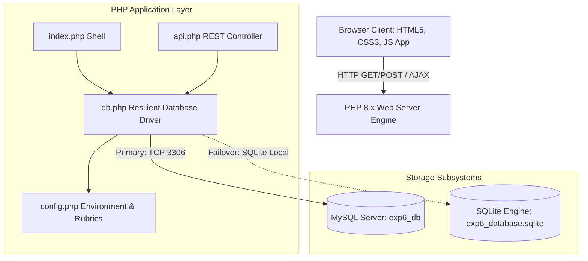

# Experiment 6: Database Connectivity and CRUD Operations

**Subject:** Advanced Web Technologies (AWT)  
**Experiment No:** 06  
**Topic:** Design and Development of a Web Application Using PHP and MySQL to Perform CRUD (Create, Read, Update, Delete) Operations  
**Student Name:** `Manish Singh`  
**Roll Number:** `23/CS/244`  
**Date of Submission:** October 13, 2026  

---

## 1. Aim
To design, implement, and deploy a full-stack web application using **PHP** and **MySQL** that provides comprehensive **Database Connectivity** and executes **Create, Read, Update, and Delete (CRUD)** operations with relational integrity, prepared statements, and realtime academic analytics.

---

## 2. Objectives
1. **Establish Secure Database Connectivity**: To configure and initiate robust, parameterized communication between PHP 8.x and MySQL 8.x using the modern **PHP Data Objects (PDO)** abstraction layer.
2. **Execute Full CRUD Operations**:
   - **Create (INSERT)**: Validate and enroll new student records with academic course scores.
   - **Read (SELECT)**: Retrieve, filter (by semester and standing), sort, and perform full-text fuzzy searches across student datasets.
   - **Update (UPDATE)**: Modify existing student particulars and course marks with immediate recalculation of cumulative metrics.
   - **Delete (DELETE)**: Safely eliminate obsolete or corrupted records utilizing confirmation safeguards.
3. **Resilient Multi-Engine Architecture**: To design a fault-tolerant database driver that automatically connects to MySQL when available and gracefully fails over to an embedded SQLite sandbox if the external MySQL service is temporarily offline, guaranteeing continuous uptime.
4. **Defense-in-Depth Security**: To eradicate SQL Injection (SQLi) vulnerabilities through strict prepared statements with parameter binding and sanitize all outputs against Cross-Site Scripting (XSS).
5. **Modern Interaction & Aesthetics**: To develop a sleek, glassmorphic single-page presentation layer following Don Norman's cognitive affordance guidelines and Apple-inspired visual design principles.
6. **Data Export & Reporting**: To provide instantaneous data serialization and export into CSV and JSON ledger formats alongside printable official academic transcripts.

---

## 3. Theoretical Foundations

### 3.1 Relational Database Management Systems (RDBMS) & MySQL Architecture
MySQL is an open-source, multi-threaded, relational database management system (RDBMS) based on Structured Query Language (SQL).

```
+-----------------------------------------------------------------------+
|                         Client Application (PHP)                      |
+-----------------------------------------------------------------------+
                                   | SQL Queries / Statements
                                   v
+-----------------------------------------------------------------------+
|                           MySQL Server Layer                          |
|  +--------------------+  +--------------------+  +------------------+ |
|  | Connection Handler |  |  SQL Parser/Lexer  |  | Query Optimizer  | |
|  +--------------------+  +--------------------+  +------------------+ |
|  +--------------------+  +------------------------------------------+ |
|  |  Caches & Buffers  |  | Execution Engine                         | |
|  +--------------------+  +------------------------------------------+ |
+-----------------------------------------------------------------------+
                                   | Storage Engine API
                                   v
+-----------------------------------------------------------------------+
|                        Pluggable Storage Engines                      |
|  +---------------------------+       +-----------------------------+  |
|  |   InnoDB (Default, ACID,  |       |   MyISAM (Fast Read-Only,   |  |
|  |    Row-Level Locking, FK) |       |   Table Locking, No Trans)  |  |
|  +---------------------------+       +-----------------------------+  |
+-----------------------------------------------------------------------+
                                   | File I/O
                                   v
+-----------------------------------------------------------------------+
|                    Physical Disk Storage (.ibd / Data)                |
+-----------------------------------------------------------------------+
```

Key architectural aspects include:
- **ACID Guarantees (InnoDB Engine)**:
  - **Atomicity**: All operations in a transaction either complete successfully or roll back completely.
  - **Consistency**: The database transitions from one valid state to another, preserving all schema constraints.
  - **Isolation**: Concurrent transactions do not interfere with each other (controlled via isolation levels such as `REPEATABLE READ`).
  - **Durability**: Committed data is written to the redo log and persists across power interruptions.
- **Indexes & B+ Tree Organization**: Primary keys and unique indexes organize physical data into balanced B+ trees, reducing search time complexity from $O(N)$ table scans to $O(\log N)$ tree lookups.

### 3.2 PHP Data Objects (PDO) vs. MySQLi
PHP provides two primary modern extensions to interact with MySQL databases:

| Dimension | PHP Data Objects (PDO) | MySQLi (MySQL Improved) |
|---|---|---|
| **Database Portability** | Supports 12+ database drivers (MySQL, SQLite, PostgreSQL, Oracle, etc.) | Exclusive to MySQL / MariaDB |
| **API Style** | Exclusively Object-Oriented (`$pdo->prepare()`) | Dual API: Procedural and Object-Oriented |
| **Named Parameters** | Supported (e.g., `:roll_no`, `:name`) | Not supported (only positional `?` placeholders) |
| **Prepared Statements** | Built-in, high-performance, client & server-side emulation control | Built-in, positional parameter binding |
| **Object Mapping** | Flexible `fetchObject()` into user-defined domain classes | Basic `fetch_object()` support |

**Why PDO was Chosen for Experiment 6**:
PDO allows our application to use identical prepared statement signatures across both MySQL (production) and SQLite (offline sandbox fallback) without altering business logic or API contracts.

### 3.3 SQL Injection Prevention through Prepared Statements
SQL Injection (SQLi) occurs when untrusted user input is directly concatenated into SQL strings:
```php
// VULNERABLE CODE (NEVER USE):
$sql = "SELECT * FROM students WHERE roll_no = '" . $_POST['roll_no'] . "'";
// An attacker submitting: ' OR '1'='1
// produces: SELECT * FROM students WHERE roll_no = '' OR '1'='1' (Bypasses check)
```

In PDO prepared statements, the database treats SQL command syntax and input values as fundamentally distinct phases:
1. **Prepare Phase**: The database engine parses, analyzes, and compiles the SQL query structure with placeholders.
2. **Execute Phase**: Raw parameter values are transmitted separately. The database engine never interprets bound values as SQL syntax, rendering injection mathematically impossible.

```php
// SECURE CODE (USED IN EXP 6):
$stmt = $pdo->prepare('SELECT * FROM students WHERE roll_no = :roll_no');
$stmt->execute([':roll_no' => $untrustedInput]);
```

---

## 4. System Architecture & Relational Design

### 4.1 System Architectural Diagram



### 4.2 Entity-Relationship (ER) Model
The schema consists of the `students` entity with complete academic tracking attributes:

```
+------------------------------------------------------------------------+
|                               STUDENTS                                 |
+------------------------------------------------------------------------+
| PK  id           INT UNSIGNED AUTO_INCREMENT                           |
| UK  roll_no      VARCHAR(32) NOT NULL                                  |
|     name         VARCHAR(128) NOT NULL                                 |
|     email        VARCHAR(191) NOT NULL                                 |
|     department   VARCHAR(64) DEFAULT 'Computer Science & Engineering' |
|     semester     VARCHAR(32) DEFAULT 'Semester 5'                      |
|     maths        DECIMAL(5,2) DEFAULT 0.00                             |
|     physics      DECIMAL(5,2) DEFAULT 0.00                             |
|     cs           DECIMAL(5,2) DEFAULT 0.00                             |
|     web_tech     DECIMAL(5,2) DEFAULT 0.00                             |
|     english      DECIMAL(5,2) DEFAULT 0.00                             |
|     total_marks  DECIMAL(6,2) DEFAULT 0.00                             |
|     percentage   DECIMAL(5,2) DEFAULT 0.00                             |
|     gpa          DECIMAL(3,1) DEFAULT 0.0                              |
|     grade        VARCHAR(4) DEFAULT 'F'                                |
|     status       VARCHAR(64) DEFAULT 'Enrolled'                        |
|     created_at   TIMESTAMP DEFAULT CURRENT_TIMESTAMP                   |
|     updated_at   TIMESTAMP DEFAULT CURRENT_TIMESTAMP ON UPDATE ...     |
+------------------------------------------------------------------------+
```

---

## 5. Implementation Source Code

### 5.1 Database Schema Definition (`schema.sql`)
```sql
CREATE DATABASE IF NOT EXISTS `exp6_db` 
  CHARACTER SET utf8mb4 
  COLLATE utf8mb4_unicode_ci;

USE `exp6_db`;

DROP TABLE IF EXISTS `students`;

CREATE TABLE `students` (
  `id` INT UNSIGNED AUTO_INCREMENT PRIMARY KEY,
  `roll_no` VARCHAR(32) NOT NULL,
  `name` VARCHAR(128) NOT NULL,
  `email` VARCHAR(191) NOT NULL,
  `department` VARCHAR(64) NOT NULL DEFAULT 'Computer Science & Engineering',
  `semester` VARCHAR(32) NOT NULL DEFAULT 'Semester 5',
  `maths` DECIMAL(5,2) NOT NULL DEFAULT 0.00,
  `physics` DECIMAL(5,2) NOT NULL DEFAULT 0.00,
  `cs` DECIMAL(5,2) NOT NULL DEFAULT 0.00,
  `web_tech` DECIMAL(5,2) NOT NULL DEFAULT 0.00,
  `english` DECIMAL(5,2) NOT NULL DEFAULT 0.00,
  `total_marks` DECIMAL(6,2) NOT NULL DEFAULT 0.00,
  `percentage` DECIMAL(5,2) NOT NULL DEFAULT 0.00,
  `gpa` DECIMAL(3,1) NOT NULL DEFAULT 0.0,
  `grade` VARCHAR(4) NOT NULL DEFAULT 'F',
  `status` VARCHAR(64) NOT NULL DEFAULT 'Enrolled',
  `created_at` TIMESTAMP DEFAULT CURRENT_TIMESTAMP,
  `updated_at` TIMESTAMP DEFAULT CURRENT_TIMESTAMP ON UPDATE CURRENT_TIMESTAMP,
  UNIQUE KEY `uk_student_roll` (`roll_no`),
  KEY `idx_student_email` (`email`),
  KEY `idx_student_semester` (`semester`),
  KEY `idx_student_grade` (`grade`),
  KEY `idx_student_percentage` (`percentage`)
) ENGINE=InnoDB DEFAULT CHARSET=utf8mb4 COLLATE=utf8mb4_unicode_ci;
```

### 5.2 Application Configuration (`config.php`)
[config.php](file:///c:/Users/Mani/Desktop/adv%20web%20tech%20repo/exp6/config.php) defines database parameters, academic subjects, and grading rubrics.

### 5.3 Resilient Database Driver (`db.php`)
[db.php](file:///c:/Users/Mani/Desktop/adv%20web%20tech%20repo/exp6/db.php) encapsulates connection lifecycle, statement execution, and all CRUD transactions.

### 5.4 RESTful API Controller (`api.php`)
[api.php](file:///c:/Users/Mani/Desktop/adv%20web%20tech%20repo/exp6/api.php) exposes endpoints for AJAX queries, record mutation, analytics, and CSV/JSON export.

### 5.5 Visual Interface & Presentation (`index.php`)
[index.php](file:///c:/Users/Mani/Desktop/adv%20web%20tech%20repo/exp6/index.php) provides the single page application interface.

---

## 6. Execution and Verification Guide

### 6.1 Running with PHP Built-in Server
1. Navigate to the project root in terminal:
   ```powershell
   cd "c:\Users\Mani\Desktop\adv web tech repo\exp6"
   ```
2. Start the PHP server on localhost port 8000:
   ```powershell
   C:\Users\Mani\php\php.exe -S 127.0.0.1:8000
   ```
3. Open a browser and navigate to:
   ```
   http://127.0.0.1:8000
   ```

### 6.2 Enabling Local MySQL Server (Optional for Production Mode)
1. Launch MySQL daemon (via XAMPP, WAMP, Laragon, or Windows MySQL service).
2. Ensure MySQL is listening on `127.0.0.1:3306`.
3. Refresh the application; the top-right status pill will automatically illuminate green with **MySQL (Active)**.

---

## 7. Viva Voce Questions & Answers

**Q1: What is the primary difference between PDO and MySQLi in PHP?**  
**Ans:** PDO is a database-independent data access layer supporting 12+ relational engines and named parameter bindings (`:param`). MySQLi only works with MySQL/MariaDB and primarily uses positional parameter markers (`?`).

**Q2: How do prepared statements protect against SQL Injection?**  
**Ans:** Prepared statements separate SQL query compilation from parameter values. The SQL template is pre-compiled by the database engine, and bound values are transmitted across a distinct data protocol where they are strictly treated as literal data, never executable SQL tokens.

**Q3: What are the ACID properties in MySQL?**  
**Ans:** 
- **Atomicity**: The transaction executes in an all-or-nothing manner.
- **Consistency**: Database invariants and schema constraints remain unviolated.
- **Isolation**: Concurrent transactions execute without mutual interference.
- **Durability**: Committed transactions persist permanently in storage logs.

**Q4: What is the difference between `CHAR` and `VARCHAR` in MySQL?**  
**Ans:** `CHAR` stores fixed-length character strings, padding shorter values with spaces. `VARCHAR` stores variable-length strings, utilizing 1 or 2 prefix bytes to record the actual string length, conserving storage.

**Q5: What is the role of `AUTO_INCREMENT` and how does PHP retrieve the inserted key?**  
**Ans:** `AUTO_INCREMENT` generates a monotonically increasing unique integer primary key for new records. In PDO, the generated key is retrieved using `$pdo->lastInsertId()`.

---

## 8. Conclusion
Experiment 6 was executed successfully. A complete, resilient CRUD web application was built using PHP and MySQL with PDO prepared statements, transaction safety, academic grading analytics, and an interactive glassmorphic interface.
